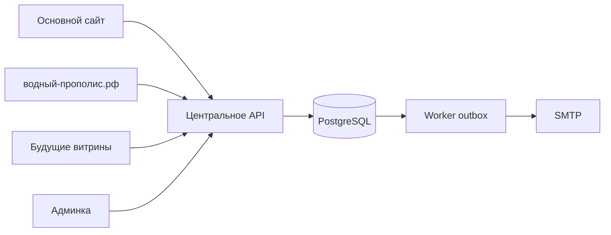

# Архитектура — решение этапа 1

Обновлено 25.10.2026: ядро/миграции (этап 2) и локальная админка (этап 3)
реализованы. Витрина, почта и публичный checkout — следующие этапы.
Подробности API — API.md, админки — ADMIN.md.

## Границы

Модульный монолит: центральное API и отдельный worker используют одну PostgreSQL.
Витрины и админка обращаются к API. Недоступность отдельной витрины не нарушает ядро.
Нет отдельных баз клиентов у лендингов, микросервисов, бонусной системы и онлайн-оплаты.

## Стек

- Node.js 24 LTS, TypeScript; npm с единым lockfile.
- Fastify 5: JSON Schema для входящих данных, сериализация ответов по явным DTO.
- PostgreSQL 18 (целевой выбор; проверить доступность у хостера), драйвер pg,
  параметризованные запросы и последовательные SQL-миграции.
- React + TypeScript + Vite для UI; публичный контент витрины предварительно
  рендерится для поиска. Детали сборки выбрать на этапе 4 после макета.
- PostgreSQL outbox и worker без Redis на старте. Повторы с backoff и журнал.
- Linux и Nginx либо Caddy, с учётом существующего сервера. Сейчас не развёрнуты.

Причина выбора: доступный Node, общий язык и контракты UI/API, строгие ограничения
и транзакции БД, небольшой набор сервисов для MVP. Это выбор по доступным сведениям;
при обнаружении рабочего проекта/сервера сначала изучить его и оформить ADR.
Версии API/pg/TypeScript закреплены в lockfile. Native PostgreSQL — dev dependency,
не production-сервис; локальный запуск без установки службы.
Локальный Node 24.18.1 не считается актуальным production patch; обновление
runtime и проверка advisories входят в подготовку запуска.

Справочные первоисточники:
- [Node LTS](https://nodejs.org/en/about/previous-releases).
- [Поддержка Fastify](https://fastify.dev/docs/latest/Reference/LTS/).
- [PostgreSQL backup](https://www.postgresql.org/docs/current/backup-dump.html).

## Модули ядра и API

Префикс `/api/v1`; реально доступные маршруты перечислены в API.md:
- Публичный каталог и информация о витрине.
- Серверный расчёт корзины с датами акции и выбранным количеством.
- Запрос/проверка email-кода и создание заказа с idempotency key (этап 5).
- Закрытые маршруты клиентов, заказов, акций, аудита и аналитики.

`storefront_id` сохраняется сервером для заказа после проверки активности и origin.
ID витрины публичен и не является авторизацией. CORS — точный allowlist;
серверная проверка прав обязательна независимо от origin и UI.
Закупочная цена доступна только внутреннему каталогу и расчёту валовой прибыли.

Цены — целые копейки, скидка — basis points. Backend определяет акцию по серверному
времени UTC: starts_at <= now < ends_at. Не более одной применимой акции на строку
в MVP; при конфликте конфигурации отклонить активацию, не суммировать скидки.
Акцию не включать до реальных согласованных дат. Заказ хранит снимки цен и условий.

Создание заказа, строк и NotificationEvents — одна транзакция. Уникальность ключа
идемпотентности и хеш запроса защищают от дублей и повторов с другим содержимым.
Повтор с иным содержимым даёт конфликт. До этапа 5 публичное создание закрыто.
Отправка SMTP не выполняется внутри транзакции. Outbox гарантирует повтор доставки,
но SMTP сам по себе не даёт exactly-once: учитывать сбой после принятия письма.

## Доступ и данные

Админские серверные сессии: HttpOnly/Secure/SameSite cookies, CSRF и роли;
хеш пароля современным алгоритмом, rate limit и аудит. Без паролей по умолчанию.
Email-код/ссылки: криптографическая генерация, HMAC/хеш, TTL, одноразовость,
лимиты попыток и отправок в общей БД (не только в памяти процесса).
Подтверждённый email не даёт доступа к истории без новой проверки владения.
Телефон +7 нормализуется, без SMS остаётся неподтверждённым.
Логи не содержат кодов, токенов, адресов, тела заказа и контактов.

До реальных ПДн требуется отдельная проверка требований РФ и инфраструктуры
оператора. В этом этапе юридическая проверка не выполнялась, разрешение на
обработку реальных данных не утверждается. См. ISSUES.md.

## Интерфейсы

Владелец 24.10.2026 потребовал сначала нарисовать макет, показать его и согласовать
корректировки. До этого не начинать вёрстку или реализацию дизайна сайта.
Макет админки просмотрен владельцем и реализован с его правками. Концепция витрины
отклонена: новое указание — история монопродукта и единый блок покупки вместо
магазинной сетки. CONCEPT_REVISION.md имеет приоритет над старой композицией ТЗ.
Материалы производителя, фотографии и документы не заменять вымышленными.

## Проверки и эксплуатация

Unit: цены и состояния; integration: настоящий PostgreSQL, транзакции и конкуренция;
API: DTO и права; E2E: полный заказ; эксплуатация: restore в изолированную БД.
На этапе 2 есть unit и integration на настоящем PostgreSQL 18.4, включая реальный
HTTP smoke-тест. CI добавлен с отдельным PostgreSQL service; удалённый результат
подтверждать отдельно. Глобальный лимит публичного API сейчас process-local;
перед несколькими экземплярами требуется общее хранилище лимитов. Для email
общие лимиты в БД реализовать на этапе 5, а не копировать этот упрощённый limiter.
